

  
  
  
  

  <a href="#about"><b>About</b></a> ·
  <a href="#stats"><b>Stats</b></a> ·
  <a href="#captain"><b>Captain</b></a> ·
  <a href="#starting-xi"><b>Starting XI</b></a> ·
  <a href="#bench"><b>Bench</b></a> ·
  <a href="#honours"><b>Honours</b></a> ·
  <a href="#toolkit"><b>Toolkit</b></a> ·
  <a href="#activity"><b>Activity</b></a> ·
  <a href="#contact"><b>Contact</b></a>

I'm **Swayam Panchal**, an AI & Data Science undergrad at **Dwarkadas J. Sanghvi College of Engineering**, Mumbai. I work across the whole path from raw data to a decision: SQL and databases, exploratory analysis and statistics, machine and deep learning models that hold up out of sample, and generative-AI systems that put those models in front of people.

I like problems where a wrong answer costs something real (freight bills, medical codes, deepfake scams, a hackathon that has to stay up for 24 hours), so I care about **validation, explainability and shipping**, not just accuracy on a notebook.

| | |
| :-- | :-- |
| 🎓 **Studying** | B.Tech, Artificial Intelligence & Data Science · DJSCE, Mumbai University · 2024 – 2028 · **CGPA 9.70** |
| 🔭 **Building** | [MIRAGE](https://github.com/SDP42/isacaps2), a deepfake and social-engineering defence engine |
| 🏟️ **Leading** | Secretary, DJS NSDC × Infomatrix · co-led **Elevate 1.0**, a 24-hour national hackathon |
| 💼 **Recently** | AI Data Analyst at **InAmigos Foundation** (Jun – Jul 2026) |
| 🧑‍🏫 **Mentoring** | Python, NumPy, Pandas and core ML at the Infomatrix Python Bootcamp |
| 📄 **Research** | Applied AI in education, written up for **IEEE** and **Springer LNCS** |
| ⚽ **Off the pitch** | Football tactics, sports analytics, explainable AI, cyber-safety |

<b>Education</b>

 

| Years | School | Qualification | Score |
| :-- | :-- | :-- | --: |
| 2024 – 2028 | Dwarkadas J. Sanghvi College of Engineering | B.Tech, AI & Data Science · Mumbai University | **9.70** CGPA |
| 2024 | Vidyaniketan Junior College of Commerce and Science | HSC · Maharashtra State Board | **87.67%** |
| 2022 | Shree Siddhi Vinayagar English High School | SSC · Maharashtra State Board | **93%** |

<a href="#top">↑ back to top</a>



<a href="https://github.com/SDP42/isacaps2"></a>

<a href="https://stadium-portfolio.vercel.app"></a>

Every project is a player, picked for a position that suits it. Click a card to open the repository; full case studies and project documents are in the **[stadium](https://stadium-portfolio.vercel.app)**.

  
  <a href="https://github.com/SDP42/LearnovaV2"></a>

  
  <a href="https://github.com/SDP42/WorldCupAI-2026"></a>

  <a href="https://github.com/SDP42/east-coast-freight-desk"></a>
  

  <a href="https://github.com/SDP42/BrainMapAI"></a>
  

  <a href="https://github.com/SDP42/SIH_PS_10"></a>
  <a href="https://github.com/SDP42/Elevate1.0"></a>

**Live demos:** [Elevate 1.0](https://elevate1-0.vercel.app) · [East Coast Freight Desk](https://east-coast-freight-desk.vercel.app) · [Smart Resort 360](https://guestexperience.vercel.app) · [Stratify](https://dombivli-hackathon-s6vb.vercel.app)

<a href="#top">↑ back to top</a>


<a href="https://stadium-portfolio.vercel.app"></a>

<b>Bench links</b>

 

| Project | What it is | Stack |
| :-- | :-- | :-- |
| [Stratify](https://dombivli-hackathon-s6vb.vercel.app) | Algorithmic trading platform with a Pandas and NumPy strategy backtester | Python · React · SQL |
| Medical AI · Chest X-ray | YOLOv9 and DenseNet-121 diagnosis on 2,000+ chest X-rays, explained with Grad-CAM | PyTorch · YOLOv9 · Grad-CAM |
| [Parallel](https://github.com/SDP42/parallel) | Attention digital twin that shows both futures of a notification before you tap | TypeScript · Python · Causal ML |
| [Smart Resort 360](https://github.com/SDP42/guestexperience) | Guest portal with a live 3D twin of a 130-suite resort and a trilingual concierge | Next.js · three.js · RAG |
| [DriftWard](https://github.com/SDP42/driftward) | Behavioural identity layer that contains hijacked AI agents with still-valid tokens | FastAPI · three.js · CUSUM |
| [CityPulse AI](https://github.com/SDP42/citypulse-ai) | Local-first civic evidence workbench where every number traces back to source rows | FastAPI · SQLite · H3 |
| [Learnova IPD](https://github.com/SDP42/LearnovaIPD) | The original engine behind Learnova, turning text-heavy decks into visual slides | Python · Groq · Gemini |
| [Football Analytics](https://github.com/SDP42/Football-Analytics) | Tactical football analytics platform, in research and architecture phase | Python · ML · CV |
| [HackNova L5614](https://github.com/SDP42/HackNova-L5614) | A logistics platform built against the clock at the HackNova L5614 hackathon | JavaScript · Python · Docker |

<a href="#top">↑ back to top</a>



| When | Role | Where | What I do |
| :-- | :-- | :-- | :-- |
| Committee | **Secretary** · DJS NSDC × Infomatrix | DJSCE | Co-led Elevate 1.0, a 24-hour national hackathon; events, sponsorships and a 47-member organising committee |
| Jun – Jul 2026 | **AI Data Analyst** | InAmigos Foundation | Data cleaning, EDA and statistical analysis in Python, Pandas and NumPy, with dashboards that drove decisions |
| Ongoing | **Mentor** | Infomatrix Python Bootcamp | Teaching juniors Python, NumPy, Pandas, Matplotlib, Seaborn and core ML through hands-on notebooks |

<a href="#top">↑ back to top</a>


| | |
| :-- | :-- |
| **Machine learning** |     |
| **Deep learning** |      |
| **GenAI & NLP** |      |
| **Data science** |      |
| **DBMS & SQL** |     |
| **Engineering** |       |

<a href="#top">↑ back to top</a>

