  
  
  
  

  <a href="#about"><b>About</b></a> ·
  <a href="#stats"><b>Stats</b></a> ·
  <a href="#captain"><b>Captain</b></a> ·
  <a href="#starting-xi"><b>Starting XI</b></a> ·
  <a href="#bench"><b>Bench</b></a> ·
  <a href="#honours"><b>Honours</b></a> ·
  <a href="#toolkit"><b>Toolkit</b></a> ·
  <a href="#activity"><b>Activity</b></a> ·
  <a href="#contact"><b>Contact</b></a>

I'm **Swayam Panchal**, an AI & Data Science undergrad at **Dwarkadas J. Sanghvi College of Engineering**, Mumbai. I work across the whole path from raw data to a decision: SQL and databases, exploratory analysis and statistics, machine and deep learning models that hold up out of sample, and generative-AI systems that put those models in front of people.

I like problems where a wrong answer costs something real (freight bills, medical codes, deepfake scams, a hackathon that has to stay up for 24 hours), so I care about **validation, explainability and shipping**, not just accuracy on a notebook.

| | |
| :-- | :-- |
| 🎓 **Studying** | B.Tech, Artificial Intelligence & Data Science · DJSCE, Mumbai University · 2024 – 2028 · **CGPA 9.70** |
| 🔭 **Building** | [MIRAGE](https://github.com/SDP42/isacaps2), a deepfake and social-engineering defence engine |
| 🏟️ **Leading** | Secretary, DJS NSDC × Infomatrix · co-led **Elevate 1.0**, a 24-hour national hackathon |
| 💼 **Recently** | AI Data Analyst at **InAmigos Foundation** (Jun – Jul 2026) |
| 🧑‍🏫 **Mentoring** | Python, NumPy, Pandas and core ML at the Infomatrix Python Bootcamp |
| 📄 **Research** | Applied AI in education, written up for **IEEE** and **Springer LNCS** |
| ⚽ **Off the pitch** | Football tactics, sports analytics, explainable AI, cyber-safety |

<b>Education</b>

 

| Years | School | Qualification | Score |
| :-- | :-- | :-- | --: |
| 2024 – 2028 | Dwarkadas J. Sanghvi College of Engineering | B.Tech, AI & Data Science · Mumbai University | **9.70** CGPA |
| 2024 | Vidyaniketan Junior College of Commerce and Science | HSC · Maharashtra State Board | **87.67%** |
| 2022 | Shree Siddhi Vinayagar English High School | SSC · Maharashtra State Board | **93%** |

<a href="#top">↑ back to top</a>

