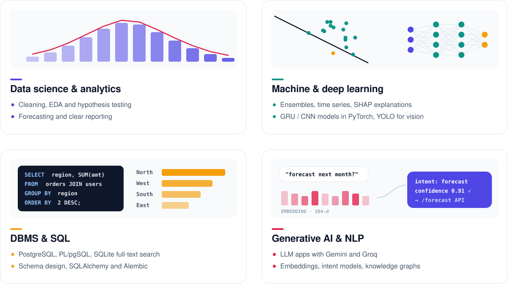
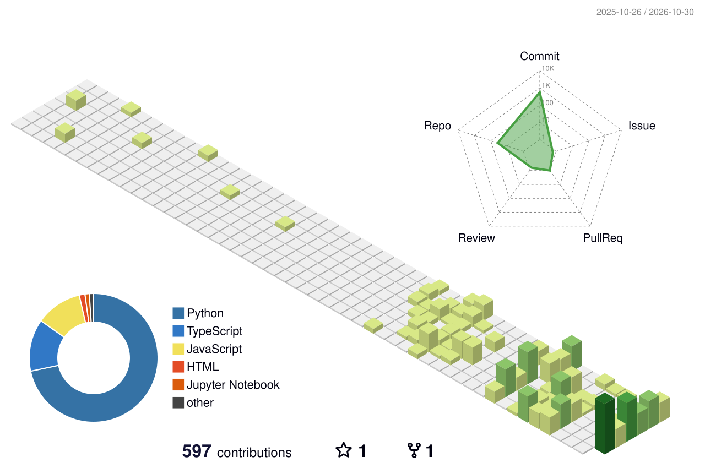

  
  
  

## About

I'm a **data science and machine learning** practitioner studying **B.Tech in Artificial Intelligence & Data Science** at **Dwarkadas J. Sanghvi College of Engineering**, Mumbai. I work across the whole path from raw data to a decision: SQL and databases, exploratory analysis and statistics, machine and deep learning models that hold up out of sample, and generative-AI systems that put those models in front of people.

|  |  |
| :-- | :-- |
| 📊 **Data science** | EDA, hypothesis testing, forecasting, Monte Carlo simulation, clear reporting |
| 🤖 **Machine learning** | Gradient boosting and ensembles, time series (ARIMA/ETS), walk-forward validation, SHAP |
| 🧠 **Deep learning** | GRU / RNN and CNN models in PyTorch and TensorFlow, YOLO object detection |
| 🗄️ **DBMS & SQL** | PostgreSQL, PL/pgSQL, SQLite FTS5, schema design, SQLAlchemy + Alembic |
| ✨ **Generative AI & NLP** | LLM apps with Gemini and Groq, sentence embeddings, intent models, spaCy and KeyBERT |
| 📄 **Research** | Applied AI in education, written up for IEEE and Springer LNCS |

## What I do

## Featured projects

Public, working projects with five or more commits. Full case studies are on my **[portfolio](https://sdp42.github.io/#work)**.

| Project | What it does | Highlights | Commits |
| :-- | :-- | :-- | --: |
| 🚢 **[East Coast Freight Desk](https://github.com/SDP42/east-coast-freight-desk)** · [live](https://east-coast-freight-desk.vercel.app) | Freight forecasting and chartering decision support for SAIL's coking-coal imports (Smart India Hackathon 2026) | ARIMA, Ridge, XGBoost and a PyTorch GRU compared walk-forward with Wilcoxon tests; ARIMA + XGBoost ensemble with SHAP; 86.9% intent model; PostgreSQL | 34 |
| 🏆 **[WorldCupAI](https://github.com/SDP42/WorldCupAI-2026)** | Predicts the FIFA World Cup 2026 knockout stage | ML + deep learning ensembles, Monte Carlo bracket simulation, SHAP, Streamlit | 8 |
| 🧭 **[DataPilot](https://github.com/SDP42/datapilot)** | Autonomous data-science pipeline that explains every step | Profiling, data quality, approval-gated cleaning, lineage, EDA, problem understanding | 71 |
| 🎓 **[Learnova V2](https://github.com/SDP42/LearnovaV2)** | Rebuilds lecture PDFs into illustrated, interactive decks | Gemini + Groq, FastAPI + React, PPTX export, 700+ tests, IEEE & LNCS papers | 178 |
| 🧠 **[BrainMapAI](https://github.com/SDP42/BrainMapAI)** | Turns PDFs and papers into navigable knowledge graphs | spaCy parsing, KeyBERT keyphrases, entity–relation graphs | 58 |
| 🩺 **[NAMASTE × ICD-11](https://github.com/SDP42/SIH_PS_10)** | FHIR R4 terminology service linking traditional and modern medical codes | 468 mappings in SQLite with FTS5 (sub-100 ms search), FastAPI, React | 40 |
| ✈️ **[Elevate 1.0](https://github.com/SDP42/Elevate1.0)** · [live](https://elevate1-0.vercel.app) | Website and portals for a 24-hour campus hackathon | Neon PostgreSQL, PL/pgSQL, role-based access, JWT + bcrypt | 145 |
| 🏨 **[Smart Resort 360](https://github.com/SDP42/guestexperience)** · [live](https://guestexperience.vercel.app) | Guest portal with a 3D digital twin and AI concierge | three.js twin, English / Hindi / Marathi understanding, automation rules | 5 |

## Toolkit

|  |  |
| :-- | :-- |
| **Machine learning** |     |
| **Deep learning** |      |
| **Generative AI & NLP** |      |
| **Data science** |       |
| **DBMS & SQL** |      |
| **Engineering** |       |

## GitHub activity

  

